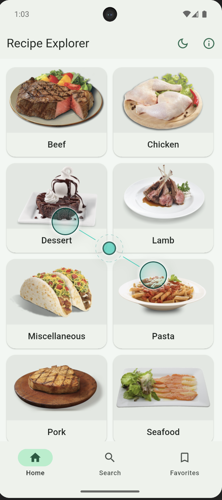
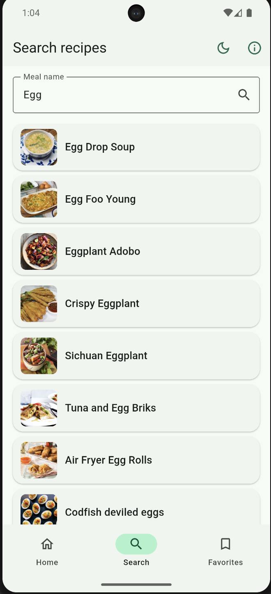
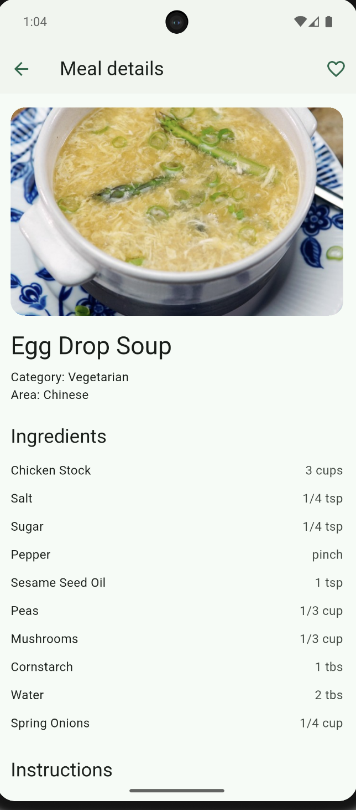
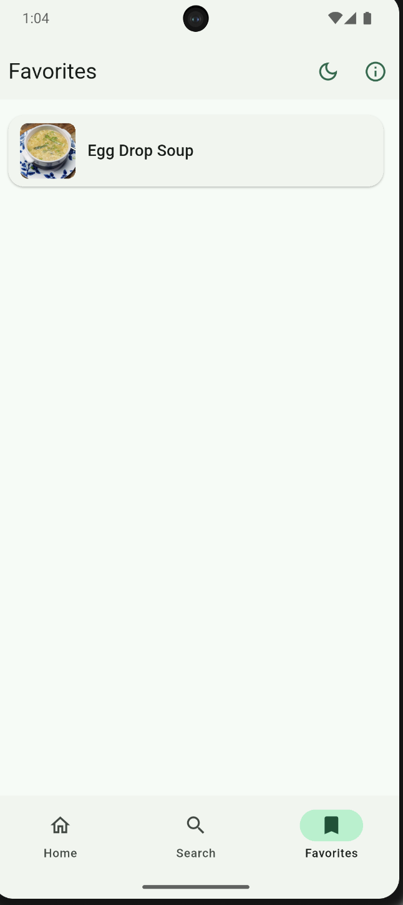
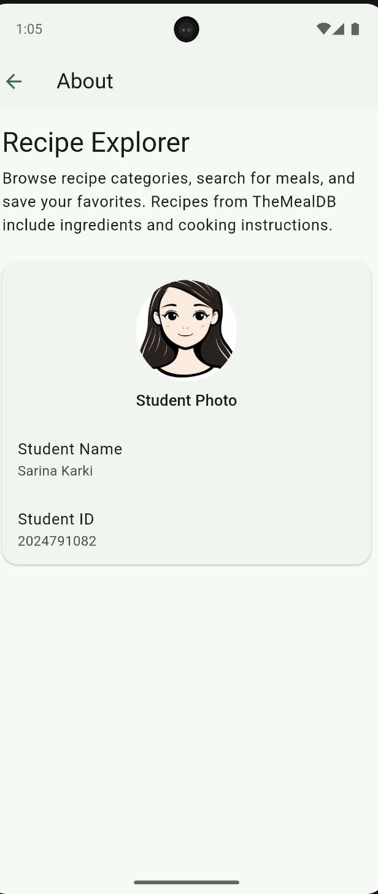
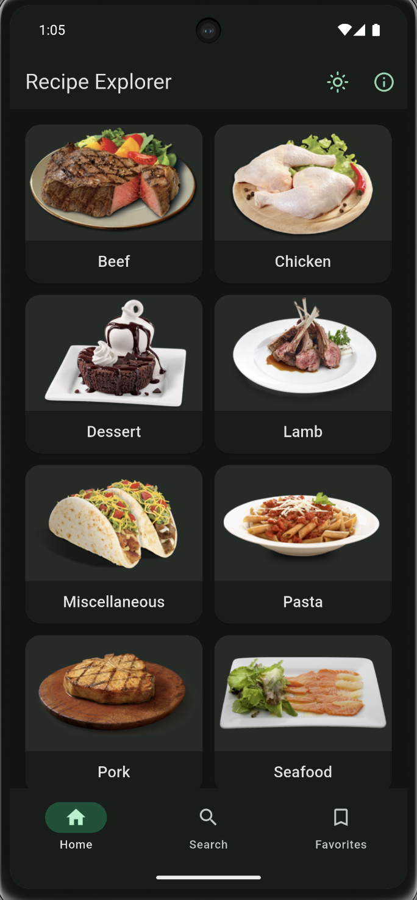

# Recipe Explorer

Recipe Explorer is a Flutter university project for discovering recipes from TheMealDB. Browse categories or search by meal name, open a recipe for ingredients and cooking instructions, and save meals to revisit later. The app uses a green Material 3 theme.

| Student | Details |
| --- | --- |
| Name | Sarina Karki |
| Student ID | 2024791082 |

## Features

1. **Category browsing** displays recipe categories with images on the Home screen.
2. **Meals by category** shows a scrollable list of meals with names and thumbnails.
3. **Recipe details** show the meal photo, category, country or area, ingredients with measurements, and full cooking instructions.
4. **Search** finds meals by name and opens the selected recipe.
5. **Persistent favorites** let users save or remove meals with the heart button. Saved meal IDs are restored when the app reopens.
6. **Bottom navigation** provides Home, Search, and Favorites tabs and preserves the current search when switching tabs.
7. **About** provides an app overview, student name, student ID, and circular profile photo.

**Bonus feature.** The moon and sun button switches between green light and dark themes. The selected mode persists across app restarts.

## Screenshots

| Home categories | Search results | Meal details |
| --- | --- | --- |
|  |  |  |

| Adding a favorite | Saved favorites | About | Dark mode |
| --- | --- | --- | --- |
|  |  |  |  |

## API and dependencies

[TheMealDB API](https://www.themealdb.com/api.php) supplies categories, meal lists, recipe details, and search results. The app uses the v1 educational test key `1` and the `categories.php`, `filter.php`, `lookup.php`, and `search.php` endpoints. Recipe data and meal images require internet access. Favorites and the theme preference are stored on the device.

The project was verified with **Flutter 3.50.1 (stable)** and **Dart 3.14.0**. The Dart SDK constraint in `pubspec.yaml` is `^3.14.0`.

| Dependency | Constraint | Purpose |
| --- | --- | --- |
| `flutter` | Flutter SDK | App framework |
| `material_ui` | `^1.1.0` | Material 3 widgets and theming |
| `cupertino_icons` | `^1.0.8` | Cupertino icon font |
| `http` | `^1.6.0` | API requests |
| `shared_preferences` | `^2.5.6` | Local favorites and theme settings |
| `flutter_test` | Flutter SDK | Unit and widget testing |
| `flutter_lints` | `^6.0.0` | Static analysis rules |

## Setup and run

Install Flutter and the Android SDK. Start an Android emulator from Android Studio, then open a terminal in the project root.

```bash
flutter pub get
flutter devices
flutter run -d emulator-5554
```

Use the ID reported by `flutter devices` if your emulator has a different ID.

## Analysis and tests

```bash
flutter analyze
flutter test
```

Unit and widget tests use mock HTTP responses, fake API services, and mocked preferences. The full suite also runs four live TheMealDB checks in `test/api_service_live_test.dart`, so it requires internet access.
